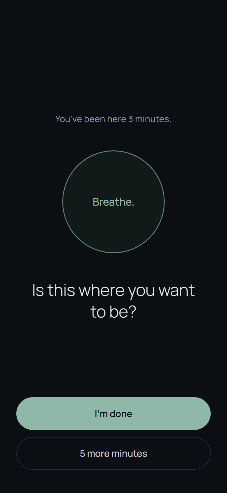
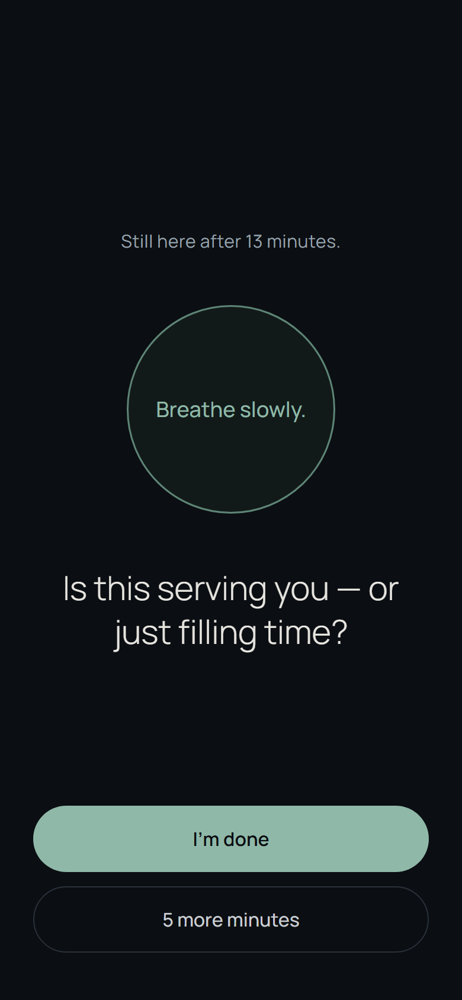
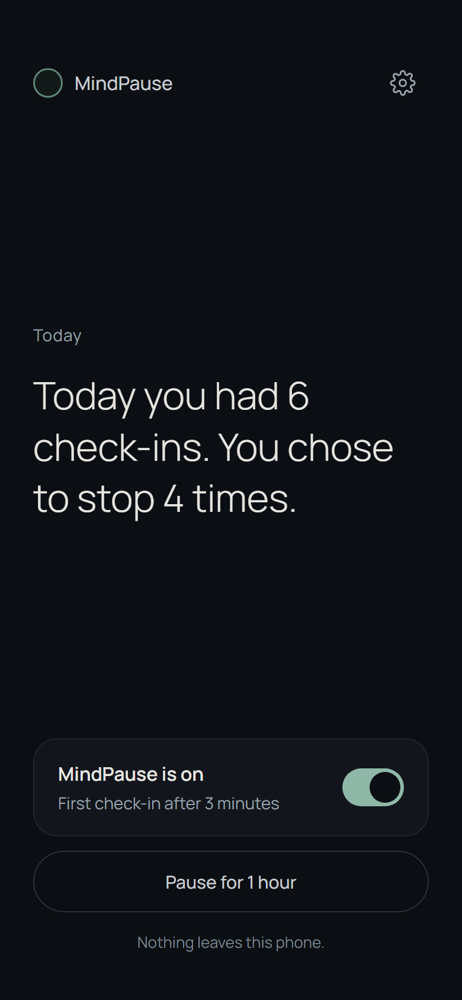
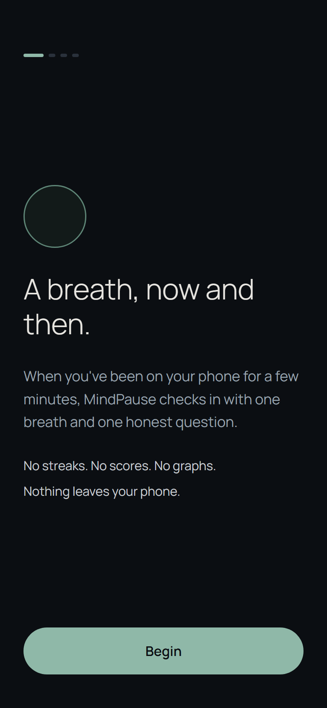
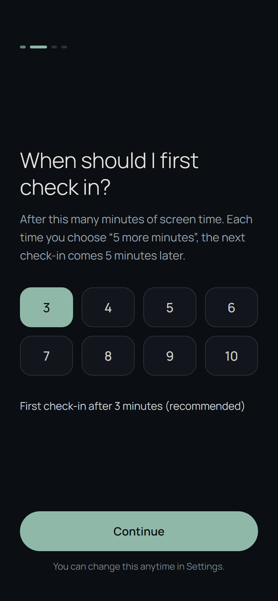
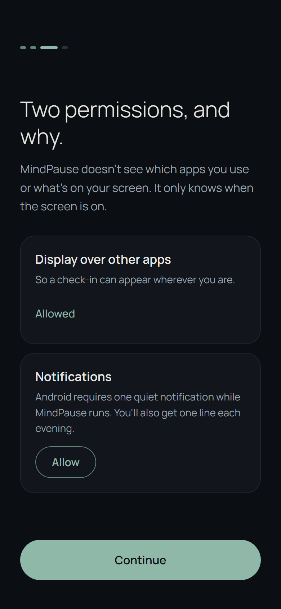
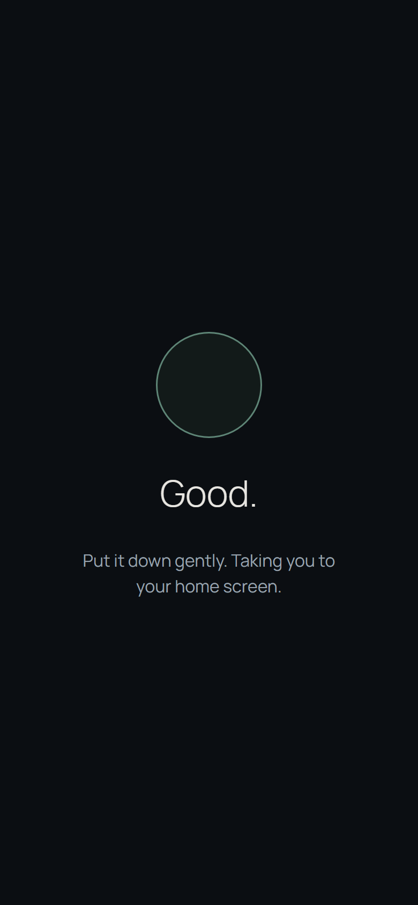
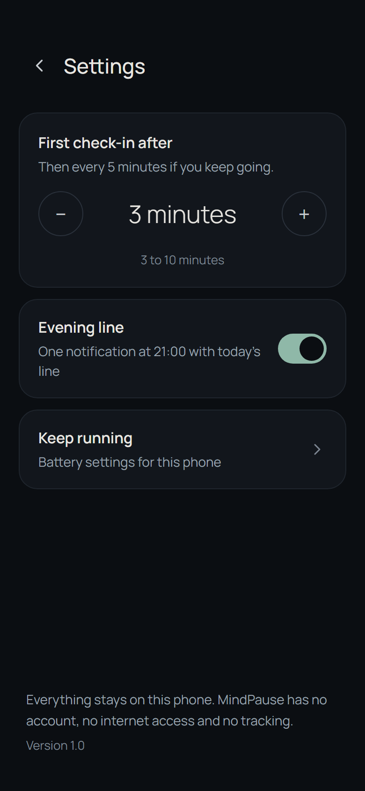
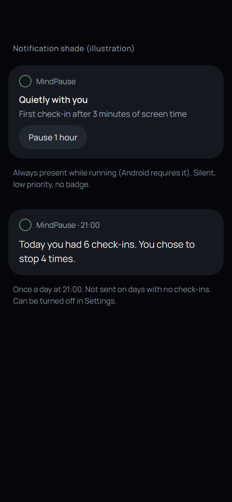

# MindPause

**A breath, now and then.**

MindPause is a small Android app that brings a moment of awareness into phone use. After a few minutes of continuous screen time it shows one calm, full-screen check-in: how long you've been here, one breath, and one honest question. You choose **I'm done** or **5 more minutes**.

No streaks. No scores. No graphs. Nothing leaves your phone.

<p align="center">
  
  
  
</p>

## How it works

1. You unlock your phone and use it as usual.
2. After your chosen interval (3 minutes by default, adjustable from 3 to 10) a check-in appears over whatever app you're in.
3. **I'm done** shows a short "Good." and takes you to your home screen.
   **5 more minutes** brings the next check-in 5 minutes later, with a slightly more direct question.
4. At the end of the day there is one line, nothing more: *"Today you had X check-ins. You chose to stop Y times."*

The questions escalate within a session:

| Check-in | Message |
|---|---|
| 1st | You've been here 3 minutes. **Breathe.** Is this where you want to be? |
| 2nd | 8 minutes. **Take one breath.** What were you looking for when you picked up your phone? |
| 3rd | Still here after 13 minutes. **Breathe slowly.** Is this serving you — or just filling time? |
| 4th and later | 18 minutes. **One breath.** What would feel better than this right now? |

The minutes shown are always the real time spent in the session.

**Session rules**

- A session starts when you unlock the phone and ends when the screen has been off for more than 30 seconds.
- After **I'm done**, a new, gentle session starts if you keep using the phone.
- MindPause never interrupts a phone call. Video and everything else get check-ins as normal.
- You can **pause for 1 hour** from the home screen or from the notification.

## Screenshots

| Welcome | Interval | Permissions |
|---|---|---|
|  |  |  |

| After "I'm done" | Settings | Notifications |
|---|---|---|
|  |  |  |

*The screenshots are rendered from the app's design files. The app looks the same, except that home uses a "Settings" text link instead of the gear icon.*

## Privacy

MindPause has **no internet permission**, no account, no analytics and no backend. It doesn't know which apps you use or what is on your screen. It only notices when the screen turns on and off. Everything it keeps (today's two counts and your settings) stays on the device.

| Permission | Why |
|---|---|
| Display over other apps | To show the check-in over whatever app is open |
| Notifications | Android requires a notification while a background service runs; also used for the optional 21:00 evening line |
| Foreground service (special use) | To keep running quietly in the background |
| Run at startup | To start again after the phone restarts |

## Install

Download the APK from the [Releases](../../releases) page and open it on your phone. Android will ask you to allow installs from that source, and Play Protect may warn about an unknown app, because this build isn't from the Play Store.

Requires Android 8.0 (API 26) or newer.

**Tip:** some phones (Samsung, Xiaomi, Huawei, OnePlus) close background apps aggressively. If check-ins stop arriving, set MindPause's battery usage to **Unrestricted** in app settings.

## Build from source

Requirements: Android Studio (recent version) with Android SDK 36.

```bash
git clone <this repository>
cd MindPause
./gradlew assembleDebug          # APK in app/build/outputs/apk/debug/
./gradlew testDebugUnitTest      # unit tests for the timing and message rules
```

## Tech

- Kotlin, Jetpack Compose (Material 3), single module, no dependency-injection library
- A foreground service listens for screen on/off and runs the session timer with coroutines
- The check-in is a `TYPE_APPLICATION_OVERLAY` window hosting Compose
- `SharedPreferences` for settings and today's counts
- One inexact daily alarm for the evening line
- Font: [Manrope](https://github.com/googlefonts/manrope) (SIL Open Font License, see `FONT-LICENSE-Manrope.txt`)

```
app/src/main/java/com/mindpause/
├── domain/      EscalationPolicy: timing, tiers and messages (pure Kotlin, unit-tested)
├── service/     PauseService, CheckInOverlay, notifications, boot receiver
├── summary/     Evening line scheduling
├── data/        Prefs: settings and today's counts
└── ui/          Onboarding, home, settings, check-in screen, theme
```
